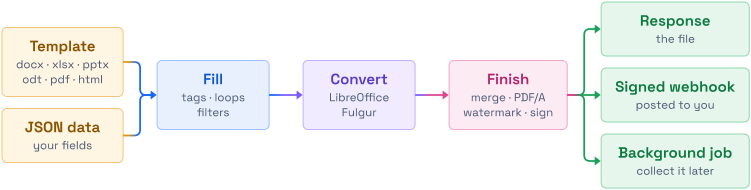

<a id="top"></a>

<p align="center">
  <a href="https://rusticdoc.com">
    <picture>
      <source media="(prefers-color-scheme: dark)" srcset=".github/assets/logo-dark.svg">
      <source media="(prefers-color-scheme: light)" srcset=".github/assets/logo-light.svg">
      
    </picture>
  </a>
</p>

<h3 align="center">Fill Office, HTML and PDF templates from JSON.<br>Convert, sign and finish them in one request, from one container.</h3>

<p align="center">
  <a href="https://rusticdoc.com/docs/"></a>
  <a href="https://rusticdoc.com/docs/start/quickstart/"></a>
  <a href="https://rusticdoc.com/docs/reference/api/"></a>
  <a href="https://rusticdoc.com/docs/project/changelog/"></a>
</p>

<p align="center">
  <a href="https://github.com/crafted-systems/rusticdoc/releases"></a>
  <a href="LICENSE"></a>
  <a href="https://github.com/crafted-systems/rusticdoc/pkgs/container/rusticdoc"></a>
  <a href="https://github.com/crafted-systems/rusticdoc/releases"></a>
  <a href="https://www.rust-lang.org"></a>
</p>

---

rusticdoc is a document engine written in Rust. It fills templates with tags like `{{ customer.name }}`, converts the result with LibreOffice or [Fulgur](https://github.com/fulgur-rs/fulgur), and finishes it with PDF operations, all in one multipart request. It handles documents, not live web pages: there's no Chromium, Node or Java in the image, no URL is fetched and no JavaScript runs.

<p align="center">
  <picture>
    <source media="(prefers-color-scheme: dark)" srcset=".github/assets/pipeline-dark.svg">
    <source media="(prefers-color-scheme: light)" srcset=".github/assets/pipeline-light.svg">
    
  </picture>
</p>

## ✨ Highlights

<table>
  <tr>
    <td width="33%" valign="top">
      <b>🧩 Templates in any format</b><br>
      Word, Excel, PowerPoint and OpenDocument files, PDF forms, HTML and plain text. Loops repeat table rows, and tags Word split across runs still work.
      <a href="https://rusticdoc.com/docs/templates/syntax/">Syntax →</a>
    </td>
    <td width="33%" valign="top">
      <b>🖼️ Rich content</b><br>
      Filters insert images, QR codes and barcodes, native charts, links, coloured text, safe HTML and page breaks.
      <a href="https://rusticdoc.com/docs/templates/rich-content/">Rich content →</a>
    </td>
    <td width="33%" valign="top">
      <b>📑 PDF toolbox</b><br>
      Merge, split, watermark, stamp, overlay, PDF/A, PDF/UA, Factur-X, encryption, bookmarks, metadata and form filling.
      <a href="https://rusticdoc.com/docs/guides/pdf-operations/">PDF operations →</a>
    </td>
  </tr>
  <tr>
    <td valign="top">
      <b>✍️ PAdES signatures</b><br>
      Cryptographic signing from B-B to B-LTA, approving or certifying, with keys on disk or a PKCS#11 token. Output validates in pdfsig and pyHanko.
      <a href="https://rusticdoc.com/docs/guides/pdf-operations/#post-v1pdfsign">Signing →</a>
    </td>
    <td valign="top">
      <b>⚡ Sync, webhook or job</b><br>
      Wait for the file, have it posted to a signed webhook, or start a background job and collect it later.
      <a href="https://rusticdoc.com/docs/guides/webhooks/">Webhooks →</a>
    </td>
    <td valign="top">
      <b>📦 Scales out</b><br>
      Replicas share only an S3 bucket or a volume. There are no locks, no leader and no messages between them.
      <a href="https://rusticdoc.com/docs/operate/many-containers/">Many containers →</a>
    </td>
  </tr>
  <tr>
    <td valign="top">
      <b>🛡️ Hardened by default</b><br>
      Templates run in limited worker processes, documents can't reach the network, and secrets stay out of child processes.
      <a href="https://rusticdoc.com/docs/operate/security/">Security →</a>
    </td>
    <td valign="top">
      <b>⌨️ CLI included</b><br>
      The same binary renders, converts and validates without the service, for scripts and CI.
      <a href="https://rusticdoc.com/docs/reference/cli/">CLI →</a>
    </td>
    <td valign="top">
      <b>🤖 Ready for agents</b><br>
      Skills for Claude Code, Codex, Cursor and Copilot, and the docs as <a href="https://rusticdoc.com/llms.txt">llms.txt</a>.
      <a href="https://rusticdoc.com/docs/ai/skills/">Agent skills →</a>
    </td>
  </tr>
</table>

## 🚀 Quickstart

Run the image, hardened:

```bash
docker run -d --name rusticdoc --read-only --cap-drop ALL --security-opt no-new-privileges \
  --tmpfs /tmp --tmpfs /home/rusticdoc:uid=1001,gid=1001 -p 127.0.0.1:9027:9027 \
  ghcr.io/crafted-systems/rusticdoc:0.1.3
```

Fill a template and get a PDF:

```bash
printf 'Dear {{ customer.name }},\nTotal: {{ total | currency("KES") }}\n' > letter.txt
curl -F template=@letter.txt -F 'data={"customer":{"name":"Ada"},"total":1500}' -F steps=convert \
  http://localhost:9027/v1/render -o letter.pdf
```

Or just convert a file:

```bash
curl -F files=@report.docx http://localhost:9027/v1/convert -o report.pdf
```

> [!WARNING]
> With no credentials configured, anyone who can reach the service can use it. Set `RUSTICDOC_API_KEYS` before you expose it, and read [security](https://rusticdoc.com/docs/operate/security/) for the rest.

[Install](https://rusticdoc.com/docs/start/install/) covers Compose, building from source and the CLI downloads for Linux and macOS.

## 🧩 Templates

The text of a Word template might read:

```text
Invoice {{ number }} for {{ customer.name }}
{{ line.item }}  {{ line.amount | currency("EUR") }}
Paid, thank you.
{{ logo | image(width=120) }}  {{ sku | barcode("qr") }}
{{ rows | chart(type="bar", x="month", y=["sales"]) }}
```

Tags work in `.docx`, `.xlsx`, `.pptx`, `.odt`, `.ods`, `.odp`, PDF form fields and text formats. `rusticdoc validate`, or `POST /v1/templates/validate`, checks a template against sample data and points at every problem. See [syntax](https://rusticdoc.com/docs/templates/syntax/), [filters](https://rusticdoc.com/docs/templates/filters/) and [PDF templates](https://rusticdoc.com/docs/templates/pdf-templates/).

## 🔌 API at a glance

| Endpoint | What it does |
|---|---|
| `POST /v1/render` | Fills a template, then runs `steps` such as `convert`, `pdfa`, `merge`, `watermark`, `encrypt` or `sign` |
| `POST /v1/render/batch` | Renders one template per element of an array and returns a ZIP |
| `POST /v1/convert` | Converts files with LibreOffice, or HTML with Fulgur, to PDF by default |
| `POST /v1/pdf/*` | Merge, split, sign, fill forms, watermark, Factur-X and more |
| `/v1/templates`, `/v1/fonts`, `/v1/jobs` | Stored templates, fonts, and background jobs |

Every operation has a curl example in the [API reference](https://rusticdoc.com/docs/reference/api/), and the service serves its own description at `/openapi.json`.

## ⌨️ CLI

```bash
rusticdoc render letter.txt --data data.json --steps convert -o letter.pdf
rusticdoc convert report.docx deck.pptx --merge -o bundle.pdf
rusticdoc pdf sign contract.pdf --key key.pem --cert cert.pem -o signed.pdf
rusticdoc serve
```

See the [CLI reference](https://rusticdoc.com/docs/reference/cli/).

## 🏗️ Deploy and operate

- **Configure** everything with environment variables, all optional. See the [configuration reference](https://rusticdoc.com/docs/reference/configuration/).
- **Store** templates, fonts and job results in S3 or a shared volume with `RUSTICDOC_STORE`. See [many containers](https://rusticdoc.com/docs/operate/many-containers/).
- **Deploy** with [`deploy/compose.yaml`](deploy/compose.yaml) or [`deploy/kubernetes.yaml`](deploy/kubernetes.yaml). See [Kubernetes](https://rusticdoc.com/docs/operate/kubernetes/) and [sizing](https://rusticdoc.com/docs/operate/sizing/).
- **Add fonts** by uploading, mounting or sending them, without a rebuild. See [fonts](https://rusticdoc.com/docs/guides/fonts/).
- **Watch** it with Prometheus metrics, health routes and a request id that follows each request through the logs and webhooks. See [observability](https://rusticdoc.com/docs/operate/observability/).

## 🤖 Agents and SDKs

[`skills/`](skills/) holds two agent skills, `rusticdoc-templates` and `rusticdoc-api`:

```bash
npx skills add crafted-systems/rusticdoc
```

TypeScript, Python and Go SDKs are generated from `openapi.json` but not published yet. See [agent skills](https://rusticdoc.com/docs/ai/skills/) and [SDKs](https://rusticdoc.com/docs/project/sdks/).

## 🛠️ Develop

```bash
make test      # unit and integration tests, no LibreOffice needed
make lint      # rustfmt and clippy
make run       # the service on 127.0.0.1:9027 with pretty logs
make docker    # the image
```

<details>
<summary>Checks that need Docker, and the workspace layout</summary>

```bash
make outbound    # crafted documents must reach no network and read no local file
make isolation   # secrets stay out of worker processes, and /proc stays closed
make disk        # one conversion cannot fill the disk
make replicas    # several containers on one store: a bucket, then a shared volume
make sign-check  # signs at every level, then validates with pdfsig and pyHanko
```

The workspace has four crates: `rusticdoc-template` (the template engine), `rusticdoc-core` (pipeline, engines, the render worker), `rusticdoc-server` (axum API, auth, webhooks, metrics, OpenAPI) and `rusticdoc` (the CLI and `serve`). The docs site lives in [`site/`](site/).

</details>

## 📍 Status

The current version is 0.1.3. Versions follow [ZeroVer](https://0ver.org/), so a new minor number may change behaviour, as the [changelog](https://rusticdoc.com/docs/project/changelog/) explains. Some things haven't been checked yet, such as the Kubernetes manifest on a production cluster, and Word's default font, Aptos, isn't in the image. The [known limits](https://rusticdoc.com/docs/project/known-limits/) list all of them. To report a vulnerability, see [SECURITY.md](SECURITY.md).

## 📄 Licence

rusticdoc is licensed under [Apache-2.0](LICENSE). The image also carries LibreOffice under MPL-2.0, and qpdf and pdfcpu under Apache-2.0, each run as a separate process. See [licence](https://rusticdoc.com/docs/project/license/).

<p align="right"><a href="#top">Back to top ↑</a></p>
