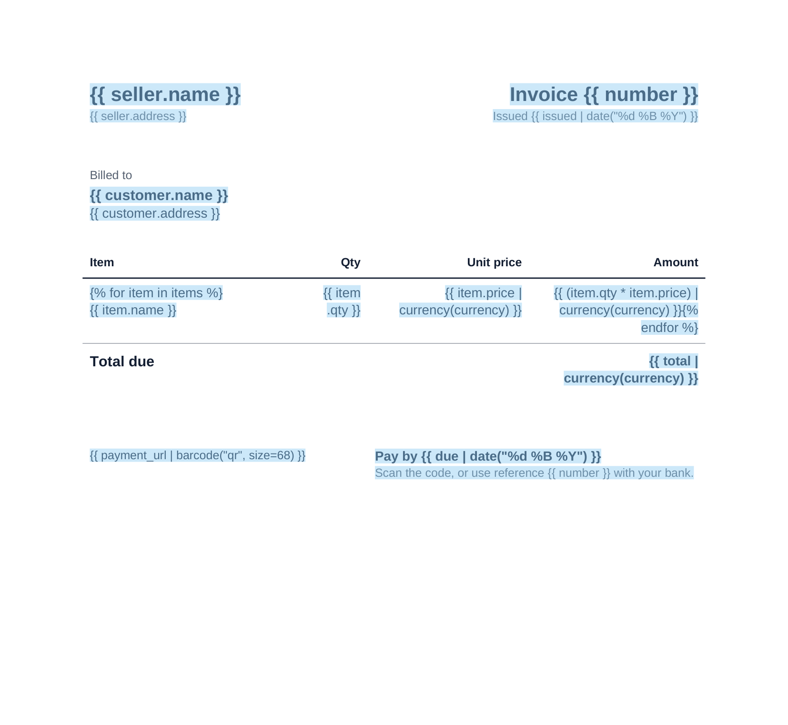
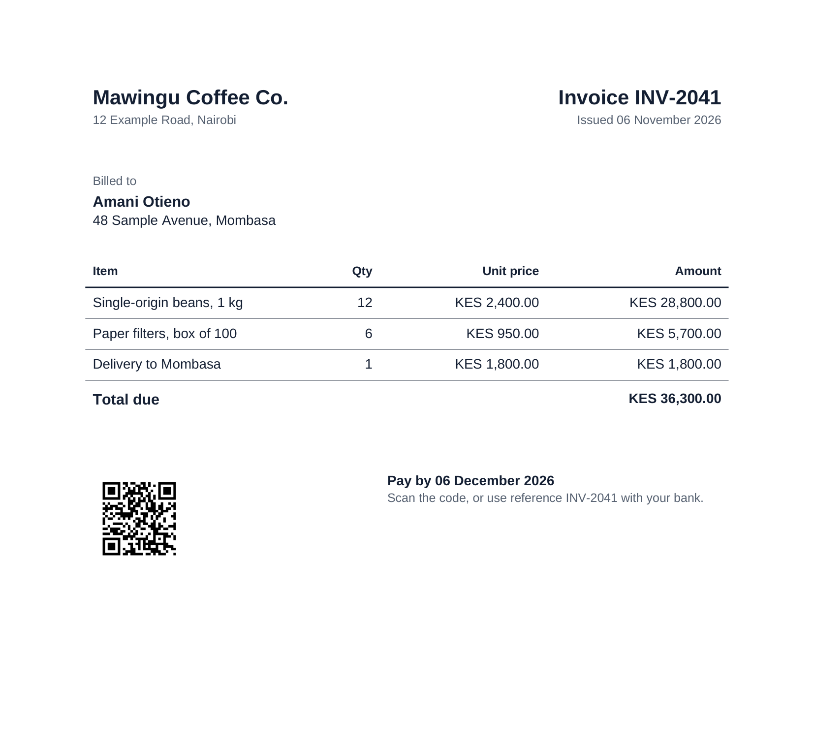

Most applications end up making documents. An invoice when an order ships. A certificate when someone finishes a course. A monthly report that somebody downloads, prints and files away. They're rarely the interesting part of a product, and they're never quite finished. Someone always wants the logo bigger, the totals in bold, one more column, the address on the other side.

For a long time we handled this the way most teams do. We wrote HTML inside the codebase, filled it with data and printed it to PDF with a headless browser. It works. It also means every change to a document is a change to code. The person who knows what the invoice should look like opens a ticket, a developer nudges a `div`, and the change waits for the next deploy.

rusticdoc is our attempt to move that work back to where it belongs.

## The template is the document

In rusticdoc, a template is an ordinary file: a Word document, an Excel workbook, a PowerPoint deck, an HTML page or a PDF form. You make it in the editor you'd use anyway, and put tags where the data goes.

Here's a real one, an invoice made in Word. The highlighted text is the tags. Everything else, from the fonts to the rule under the table header, is plain Word formatting:



The data is plain JSON, shaped however suits your application:

```json title="invoice.json"
{
  "seller": { "name": "Mawingu Coffee Co.", "address": "12 Example Road, Nairobi" },
  "number": "INV-2041",
  "issued": "2026-11-06",
  "due": "2026-12-06",
  "currency": "KES",
  "customer": { "name": "Amani Otieno", "address": "48 Sample Avenue, Mombasa" },
  "items": [
    { "name": "Single-origin beans, 1 kg", "qty": 12, "price": 2400 },
    { "name": "Paper filters, box of 100", "qty": 6, "price": 950 },
    { "name": "Delivery to Mombasa", "qty": 1, "price": 1800 }
  ],
  "total": 36300,
  "payment_url": "https://pay.example.com/INV-2041"
}
```

You send the two together in one request:

```bash
curl -F template=@invoice-template.docx -F "data=<invoice.json" -F steps=convert \
  http://localhost:9027/v1/render -o invoice.pdf
```

And this is the PDF that comes back. The loop has repeated the table row once per item, the amounts are formatted as Kenyan shillings, the dates are spelled out, and the payment link has become a QR code:



You can download the [template](/samples/invoice-template.docx), the [data](/samples/invoice.json) and the [PDF](/samples/invoice.pdf) to try it yourself.

Notice what your code had to know: only the data. The fonts, the spacing, the table borders and the wording all live in the `.docx`, and anyone who can use Word can change them. When they do, nothing has to be redeployed.

That's the whole idea. Most of what follows is about making it hold up once real templates meet real data.

## What happens in one request

A call to `/v1/render` goes through up to three stages.

First, the template is filled. Tags use a Jinja-style syntax, evaluated by minijinja, so loops, conditions and filters behave the way you'd expect if you've used Jinja or Twig. A loop inside a Word table repeats the row. A tag that Word quietly split into pieces, because you fixed a typo halfway through it, still works. Filters format money, dates and numbers for 62 languages and regions, and insert images, QR codes, barcodes and native charts.

Then, if you ask for it, the result is converted. Office files go through LibreOffice. HTML goes through [Fulgur](https://github.com/fulgur-rs/fulgur), a layout engine for print, so there's no browser in the image at all.

Last, PDF steps run on the output. Merge it with other files, add a watermark, make it PDF/A for archiving, encrypt it, or sign it with a PAdES signature that validates in tools like pdfsig and pyHanko.

You list the steps you want and get one file back. For longer work, you can have the result posted to a signed webhook instead, or start a background job and collect it later.

## A missing value is an error

One decision shaped a lot of the design. If a template asks for `customer.vat_number` and the data doesn't have it, rusticdoc stops and says so, instead of printing a blank and carrying on.

A silent blank is the worst kind of document bug, because nobody notices until a customer does. So rendering is strict, and there's a validator to go with it. `rusticdoc validate` on the command line, or `POST /v1/templates/validate` over HTTP, checks a template against sample data and lists every problem at once, with where each one is. It's worth running in CI whenever someone touches a template.

## Yours to run

rusticdoc runs on your own servers. It's one container image, for amd64 and arm64, that sits next to your application, and your documents never leave your infrastructure.

Because it accepts files from outside, we built it on the assumption that one day it will be sent a hostile one. Templates are filled in limited worker processes. Documents can't reach the network: no URL is fetched, no JavaScript runs, and images arrive inline as base64 rather than as links. Secrets such as signing keys stay out of the processes that handle documents. The repository has a check for each of these that runs against a real container.

When one container isn't enough, you run more. Replicas share only an S3 bucket or a volume, for stored templates, fonts and job results. There are no locks, no leader and no messages between them.

The same binary also works as a command-line tool, so a script or a CI job can render, convert and validate without starting the service:

```bash
rusticdoc render letter.txt --data data.json --steps convert -o letter.pdf
```

## Why Rust

We wanted a service that starts quickly, sits lightly in memory while it waits, and copes with a strange file without falling over. Rust gave us that, along with one binary that the container and the CLI share. LibreOffice still does the Office conversion, and qpdf and pdfcpu help with some of the PDF work. Everything around them, from reading templates to running the pipeline, is Rust.

## What it isn't

rusticdoc isn't a browser. If you need to print a live web page, run its JavaScript or screenshot a URL, a Chromium-based tool like Gotenberg is the better fit. We wrote [a comparison of the two](/docs/compare/gotenberg/) that tries to be fair to both.

It also has rough edges, and we keep a list of them. [Known limits](/docs/project/known-limits/) is worth five minutes before you depend on it. It covers things like spreadsheet features a loop doesn't follow and the signing keys that aren't supported.

## Try it

You need Docker and about five minutes. Start the service:

```bash
docker run -d --name rusticdoc -p 127.0.0.1:9027:9027 ghcr.io/crafted-systems/rusticdoc:0.2.0
```

Then fill your first template:

```bash
printf 'Dear {{ customer.name }},\nTotal: {{ total | currency("KES") }}\n' > letter.txt
curl -F template=@letter.txt -F 'data={"customer":{"name":"Ada"},"total":1500}' -F steps=convert \
  http://localhost:9027/v1/render -o letter.pdf
```

The [quickstart](/docs/start/quickstart/) takes it from there to a filled invoice, and the [docs](/docs/) cover templates, the API and running the service on your own servers.

rusticdoc is open source under the Apache-2.0 licence and lives [on GitHub](https://github.com/crafted-systems/rusticdoc). If something doesn't work the way this post says it should, [open an issue](https://github.com/crafted-systems/rusticdoc/issues). That's the most useful thing you can tell us.
